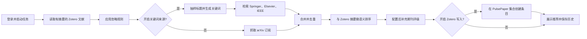

# PulsePaper

[English](README.en.md) · [简体中文](README.cn.md)

PulsePaper 根据 Zotero 文献库发现相关论文。它可以检索 arXiv、Springer Nature、Elsevier 和 IEEE，使用本地句向量模型对候选论文排序，在网页中展示进度和历史，并可选择将推荐结果写回 Zotero。

## 环境要求

- Python 3.10 或更新版本；访问 Zotero、论文来源及首次下载模型需要网络连接。
- Zotero 用户文库 ID 和具有读取权限的 API Key。只有开启写入功能时才需要写入权限。
- 开启商业论文来源时，需要相应来源的 API Key。使用 Springer、Elsevier 或 IEEE 时，还需要兼容 Anthropic Messages 接口的关键词服务及其 Key。
- 首次排序会通过 `sentence-transformers` 下载 `avsolatorio/GIST-small-Embedding-v0`。可用 CPU，CUDA 可选。

## 本地启动

```bash
git clone https://github.com/Taylor-zym/PulsePaper.git
cd PulsePaper
python3 -m venv .venv
source .venv/bin/activate
pip install -r requirements.txt
cp config/settings.example.json config/settings.json
```

Windows 上使用 `.venv\Scripts\activate` 激活环境，使用 `copy config\settings.example.json config\settings.json` 复制配置。

首次启动前，编辑 `config/settings.json`，为 `auth.admin_password` 设置一个独立的强密码。未设置时，程序会拒绝创建管理员。Zotero 和论文来源的 Key 可暂时留空，登录后在**绑定配置**页面填写个人凭证。多人共用时，`providers` 可提供全局默认 Key，`zotero` 可提供默认文库；此文件须保密。

```bash
python app.py
```

访问 <http://127.0.0.1:8000>，使用 `auth.admin_user` 和刚设置的密码登录，再到**绑定配置**填写 Zotero 文库 ID 和 API Key。示例配置只开启 arXiv，并关闭 Zotero 写入。可在工作流表单中调整查询条件或开启其他来源；开启前要配置对应 Key。

如需关键词服务，在 `providers.gemini_api_key`（或 `providers.keyword_api_key`）填写 Key，并将 `keyword_service.base_url` 和 `keyword_service.model` 配成支持 Anthropic `/v1/messages` 的服务。示例地址为 Anthropic 公共 API。只选 arXiv 时会跳过关键词生成。

## 推荐工作流



表单还可增加研究主题提示；**一句话直查**会直接从提示提取关键词，跳过 Zotero 标题生成。`sample_ratio` 控制生成关键词时抽样的标题比例，`selected_keyword_count` 控制所选关键词数量，`candidate_pool_per_source` 控制每个来源的检索量，`top_k` 控制展示的推荐数量。任务在后台运行，页面轮询进度，并支持停止。管理员可设置每位用户的每日检索次数（默认 3 次）。历史保存在本地 `data/workflow_history.json`，账号和绑定信息保存在 `data/users.json`。

程序本身没有定时调度。“今日”指从页面或认证后的 `POST /api/workflows/today` 主动触发一次。若部署到多人可访问的服务器，请自行配置 HTTPS 和进程管理；内置 Flask 服务器用于本地运行。

## 配置与隐私

| 路径 | 内容 | 是否上传 |
| --- | --- | --- |
| `config/settings.example.json` | 安全配置模板 | 是 |
| `config/settings.json` | 管理员密码、可选的全局 Key | 否 |
| `data/users.json` | 用户、密码哈希、Zotero 绑定 | 否 |
| `data/workflow_history.json` | 运行历史和论文数据 | 否 |
| `gemini/config.json` | 可选的旧版关键词服务配置 | 否 |

请勿提交本地日志、备份压缩包、代理地址、凭证或用户数据。若 Key 曾被公开，应到对应服务商处更换。`write_to_zotero` 默认关闭；仅在需要创建文库条目时开启。

## 测试与代码结构

```bash
pip install -r requirements-dev.txt
python -m pytest tests/test_app_auth.py tests/test_app_stop.py tests/test_keyword_generator.py tests/test_workflow_service.py
```

`app.py` 提供网页与 API；`workflow_service.py` 编排流程；`arxiv_source.py`、`Springer/`、`Elsevier/`、`IEEE/` 检索论文；`zotero_keyword_generator.py` 调用关键词服务；`recommender.py` 排序；`journal_rank.py` 补充期刊信息；`static/` 和 HTML 文件实现界面。API 测试使用模拟服务与临时数据，无需真实 Key。

## 许可证与来源

项目使用 GNU AGPL v3，包含基于 [zotero-arxiv-daily](https://github.com/TideDra/zotero-arxiv-daily) 修改的代码。详见 [LICENSE](LICENSE) 和 [NOTICE](NOTICE.md)。
