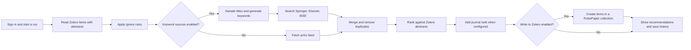

# PulsePaper

[English](README.en.md) · [简体中文](README.cn.md)

PulsePaper discovers papers relevant to your Zotero library. It can search arXiv, Springer Nature, Elsevier, and IEEE, rank the results with a local sentence embedding model, show progress and history in a web interface, and optionally write selected recommendations to Zotero.

## Requirements

- Python 3.10 or newer and internet access for Zotero, paper sources, and the first model download.
- A Zotero user library ID and API key with read access. Write access is needed only if you enable saving recommendations.
- API keys for any commercial source you enable. A key for an Anthropic Messages compatible service is needed when Springer, Elsevier, or IEEE is enabled.
- The first embedding run downloads `avsolatorio/GIST-small-Embedding-v0` through `sentence-transformers`. CPU works; CUDA is optional.

## Start locally

```bash
git clone https://github.com/Taylor-zym/PulsePaper.git
cd PulsePaper
python3 -m venv .venv
source .venv/bin/activate
pip install -r requirements.txt
cp config/settings.example.json config/settings.json
```

On Windows, activate with `.venv\Scripts\activate` and copy the file with `copy config\settings.example.json config\settings.json`.

Edit `config/settings.json` and set a unique `auth.admin_password` before the first launch. The app refuses to create a new administrator without it. You can leave the Zotero and provider keys empty here and enter your own Zotero and source keys on the **Bindings** page after signing in. For a shared instance, `providers` supplies server wide defaults; `zotero` can supply a library default. Keep this file private.

```bash
python app.py
```

Open <http://127.0.0.1:8000>, sign in with `auth.admin_user` and your chosen password, then add your Zotero library ID and key on **Bindings**. The default configuration enables arXiv only and keeps Zotero writing disabled. Choose a query or other sources in the workflow form and start a run. Do not enable a source until its required key is configured.

To use a keyword service, set `providers.gemini_api_key` (or `providers.keyword_api_key`) and configure `keyword_service.base_url` and `keyword_service.model` for a service implementing Anthropic `/v1/messages`. The example points to the public Anthropic API. When only arXiv is enabled, keyword generation is skipped.

## Recommendation workflow



The form can also add a topic hint, or use **direct sentence search** to derive keywords from that hint without generating them from Zotero titles. `sample_ratio` controls how many Zotero titles feed keyword generation; `selected_keyword_count` controls the sampled keywords; `candidate_pool_per_source` controls retrieval depth; and `top_k` controls the displayed recommendation count. Search runs asynchronously, and the UI polls progress. You can stop a run from the UI. Each user has a daily search limit set by the administrator (default: 3). History is stored locally in `data/workflow_history.json`; user accounts and bindings are stored in `data/users.json`.

The app does not schedule itself to run each day. “Today” means a run you start from the UI or `POST /api/workflows/today` after authentication. If you deploy it to a shared host, supply HTTPS and your own process management. The built in Flask server is intended for local use.

## Configuration and privacy

| Path | Purpose | Published? |
| --- | --- | --- |
| `config/settings.example.json` | Safe configuration template | Yes |
| `config/settings.json` | Administrator password, optional shared keys | No |
| `data/users.json` | User accounts, password hashes, Zotero bindings | No |
| `data/workflow_history.json` | Run history and paper data | No |
| `gemini/config.json` | Optional legacy keyword service settings | No |

Do not commit local logs, archives, proxy URLs, credentials, or user data. If any key has previously been published, rotate it with its provider. `write_to_zotero` is off by default; enable it only when you want PulsePaper to create items in your library.

## Tests and project layout

```bash
pip install -r requirements-dev.txt
python -m pytest tests/test_app_auth.py tests/test_app_stop.py tests/test_keyword_generator.py tests/test_workflow_service.py
```

`app.py` serves the UI and API; `workflow_service.py` coordinates the run; `arxiv_source.py`, `Springer/`, `Elsevier/`, and `IEEE/` fetch papers; `zotero_keyword_generator.py` calls the keyword service; `recommender.py` ranks papers; `journal_rank.py` optionally enriches journals; `static/` and the HTML files contain the interface. API tests use mocks and temporary data; they do not need live service credentials.

## License and credit

GNU AGPL v3. PulsePaper includes work derived from [zotero-arxiv-daily](https://github.com/TideDra/zotero-arxiv-daily). See [LICENSE](LICENSE) and [NOTICE](NOTICE.md).
